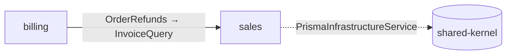

# API Reference

Technical specification of the command-line interface of `@domain-first/project-structure`.

- [Package](#package)
- [Commands overview](#commands-overview)
- [Non-interactive JSON mode](#non-interactive-json-mode)
- [`df-init`](#df-init)
- [`df-scaffold`](#df-scaffold)
    - [Run lifecycle](#run-lifecycle)
    - [Project root](#project-root)
    - [Main menu](#main-menu)
    - [Layer menus](#layer-menus)
- [Configuration file](#configuration-file)
    - [Fields](#fields)
    - [Package integrations](#package-integrations)
- [Naming](#naming)
- [Bounded context generators](#bounded-context-generators)
    - [New bounded context](#new-bounded-context)
    - [New Aggregate](#new-aggregate)
    - [New Entity and New Value Object](#new-entity-and-new-value-object)
    - [Errors](#errors)
    - [New Service](#new-service)
    - [New Use Case](#new-use-case)
    - [New Command and New Query](#new-command-and-new-query)
    - [New Port](#new-port)
    - [New Implementation](#new-implementation)
    - [New Handlers-REST Endpoint](#new-handlers-rest-endpoint)
- [Wiring](#wiring)
    - [`envBranchedWire`](#envbranchedwire)
    - [Dependency selection](#dependency-selection)
    - [Wire dependency](#wire-dependency)
    - [Move or rename](#move-or-rename)
    - [Dependency rules](#dependency-rules)
- [Unit tests](#unit-tests)
- [React modules (`df-react`)](#react-modules-df-react)
    - [New page](#new-page)
    - [New widget](#new-widget)
    - [New UI-kit component](#new-ui-kit-component)
    - [New shared hook](#new-shared-hook)
    - [Move or rename page / widget](#move-or-rename-page--widget)
    - [Delete page / widget](#delete-page--widget)
- [Integrations](#integrations)
    - [REST endpoint generator](#rest-endpoint-generator)
    - [In-memory DB](#in-memory-db-1)
    - [Storybook (React + Vite)](#storybook-react--vite)
    - [Prisma 8 (PostgreSQL, RC)](#prisma-8-postgresql-rc)
    - [Vitest](#vitest)
    - [Playwright](#playwright)
    - [Integration tests (Testcontainers, PostgreSQL)](#integration-tests-testcontainers-postgresql)
    - [OpenAPI](#openapi)
    - [Orval (API client)](#orval-api-client)
    - [Package scripts](#package-scripts)
- [`df-skills`](#df-skills)
- [`df-lint`](#df-lint)
- [`df-upgrade`](#df-upgrade)
- [`df-graph`](#df-graph)
- [Runtime semantics](#runtime-semantics)

Notation used below:

- `<rootFolder>` is the `project.rootFolder` value of the [configuration file](#configuration-file), relative to the project root.
- `<context>` is the folder of the selected bounded context: `<rootFolder>/bounded-contexts/<name>`. In the Shared Kernel, it is `<rootFolder>/shared-kernel`.
- `<name>` is the entered name as is, `<Name>` its class form and `<nameVar>` its variable form. See [Naming](#naming).
- An **implementation label** is a name such as `prisma`, `in-memory`, `api` or `mock`. It names the folder and the class prefix of an implementation: `prisma` gives `infrastructure/repositories/prisma/prisma-order-repository.ts` with `PrismaOrderRepository`.
- **With `wire`**, **with `handlers`** etc. mean that `backend.domainFirstPackages` includes `@domain-first/wire`, `@domain-first/handlers` etc.
- **With tests** means that `backend.testingLibrary` is set.

## Package

| Property       | Value                                                    |
| -------------- | -------------------------------------------------------- |
| Name           | `@domain-first/project-structure`                        |
| Binaries       | `df-init`, `df-scaffold`, `df-react`, `df-integration`, `df-skills`, `df-lint`, `df-upgrade`, `df-graph` |
| Programmatic   | None: the package is a CLI and exports no public API     |
| Shipped files  | `dist`, `bin`, `skills`                                  |
| Dependencies   | `@inquirer/prompts`, `zod`                               |
| Runtime        | Node.js 22.13+ within the Node 22 release line, or 24+   |
| Interaction    | `df-scaffold`, `df-react`, `df-integration`: interactive by default, or `--describe` / `--request <json|->`; `df-init` stays interactive with `--section` and `--help` |

## Commands overview

| Command          | Purpose                                                              | Section                       |
| ---------------- | -------------------------------------------------------------------- | ----------------------------- |
| `df-init`        | Initializes a project: the configuration file and Shared Kernel files | [`df-init`](#df-init)         |
| `df-scaffold`    | Scaffolds bounded contexts and their components                      | [`df-scaffold`](#df-scaffold) |
| `df-react`       | Scaffolds, moves and renames React modules                           | [React modules](#react-modules-df-react) |
| `df-integration` | Adds integrations: Storybook, Prisma, Vitest, Playwright, OpenAPI, … | [Integrations](#integrations) |
| `df-skills`      | Copies the bundled agent skills into a project or the home directory | [`df-skills`](#df-skills)     |
| `df-lint`        | Reports code that breaks the Domain-First rules                      | [`df-lint`](#df-lint)         |
| `df-upgrade`     | Brings the project up to date after a package upgrade                 | [`df-upgrade`](#df-upgrade)   |
| `df-graph`       | Prints the contexts and their dependencies as a Mermaid chart         | [`df-graph`](#df-graph)       |

```bash
npx df-init
npx df-scaffold
npx df-react
npx df-integration
npx df-skills [--claude] [--codex] [--global]
npx df-lint [rootFolder]
npx df-upgrade [--dry-run] [--yes]
npx df-graph [--context <name>] [--json | --markdown | --html] [--out <file>]
```

## Non-interactive JSON mode

`df-scaffold`, `df-react` and `df-integration` support a machine-readable interface for agents. Their ordinary invocation keeps the interactive workflow. `df-init` and `df-upgrade` remain human commands; `df-lint`, `df-skills` and `df-graph` already run without interactive generation menus.

```bash
npx df-scaffold --describe
npx df-scaffold --request '{"operation":"query","context":"sales","name":"orders","implementation":{"type":"prisma","save":false},"dependencies":{"PrismaOrdersQuery":["shared-kernel:PrismaInfrastructureService"]}}'
npx df-react --request '{"operation":"page","name":"admin/orders"}'
npx df-integration --request '{"operation":"add","integrations":["storybook"]}'
```

`--request` accepts a JSON literal, or `-` for one JSON document on stdin. `--describe` and `--request` are mutually exclusive. There is no prompt fallback: malformed requests, missing parameters and invalid selections return a JSON error with exit code 1.

### Discovery and request schemas

`--describe` returns `schemaVersion: 1`, the command name, a JSON Schema in `requestSchema`, and the current project inventory. It works before initialization, but execution requires the appropriate configured section. `project.configStatus` is `missing`, `outdated` (a config of an earlier major version: execution returns `CONFIG_OUTDATED`) or `current`; only a current config is `configured`.

The inventory includes contexts (`shared-kernel` is reserved for the Shared Kernel), units, contracts, modules, eligible dependencies per implementation, saved/system implementation types, integration IDs/availability and React modules. IDs are strings:

| Kind | Example | Request use |
| --- | --- | --- |
| Context | `sales`, `shared-kernel` | `context`, `targetContext` |
| Dependency / handler | `shared-kernel:PrismaInfrastructureService`, `billing:InvoiceQuery` | `dependencies`, `handler` |
| Wiring target | `sales:OrdersQuery:PrismaOrdersQuery` | `module` for `wire-dependency` |
| Unit / contract | `query:orders`, `aggregate:order`, `entity:order/line` | `module` for backend moves, `contract` for implementations |
| React module | `admin/orders` | `module` for React moves |

Dependency availability follows the same context, layer and per-kind rules as the interactive menus. Already-wired dependencies are excluded from the available lists. Refresh inventory after changes; never use display labels or list indexes as IDs.

### Operations and options

The installed schema is authoritative and rejects unknown fields. Backend operations are `bounded-context`, `aggregate`, `entity`, `value-object`, `error`, `error-namespace`, `domain-service`, `application-service`, `infrastructure-service`, `presentation-service`, `use-case`, `command`, `query`, `port`, `implementation`, `endpoint`, `wire-dependency`, `move`, `delete`. React operations are `page`, `widget`, `ui-kit-component`, `shared-hook`, `move-page`, `move-widget`, `delete-page`, `delete-widget`, `move-ui-kit-component`, `move-shared-hook`, `delete-ui-kit-component`, `delete-shared-hook`. Integrations use `operation: "add"` and an `integrations` list.

- `name` and `context` use lowercase kebab-case. React page/widget names allow nested paths. Shared Kernel restrictions match the menus.
- `implementation` and optional `testImplementation` are `{ "type": "prisma", "save": false }`. The primary type is required for queries, commands, ports and new implementations. `save` defaults to false; true records an ordinary type by category and environment role. System labels are plain `cross-context` / `in-memory`, without the UI prefix. Their existing behavior and boundaries remain in force.
- Aggregates use `withRepository: true` plus an implementation when a repository is wanted; absent means no repository. Entities/value objects may specify `aggregate`; errors may specify an existing `namespace`.
- `dependencies` maps each implementation/class name to qualified dependency IDs. Omitted entries keep checked suggestions; an explicit `[]` disables suggestions. Every supplied group must apply to the operation, otherwise nothing is written.
- New implementations select a `contract` and, with a branched wire, an explicit nonempty `environments` list. Their dependency groups refer to the new concrete class.
- Backend moves select a unit ID in `module`, with optional `name`, `targetContext` and `aggregate`. React moves use `module` and a new nested `name`. Moves use the same validation/import rewriting as the menus.
- Endpoints use `controller`, `method`, `path` and a qualified `handler` when a wired handler is available. A missing controller is created; without `controller`, the endpoint belongs to the context-root controller `(root)` (`/<context>/<path>`). REST tooling must already be configured.
- Integration IDs are `storybook`, `rest-endpoint-generator`, `in-memory-db`, `prisma`, `vitest`, `playwright`, `testcontainers`, `openapi`, `orval`. Optional integration-specific fields include `nextAdapter`, `withService`, `configureReact`, `replaceTestingLibrary`, `openapiPath`, `routePrefix`, `withExtractor`, `swaggerPage`, `targets`. Conditional configuration changes require their explicit boolean field. Script conflicts require `scriptConflicts: { "storybook": "keep" }` (`keep`, `replace`, `rename`); renames also use `scriptNames`.
- `dryRun: true` computes the full proposed operation without writing anything.
- `overwrite: true` allows replacing changed existing generated files. Without it the command returns `OVERWRITE_REQUIRED` and the affected paths. Identical generated contents do not require this flag. Metadata edits such as implementation choices and normal wiring updates retain their existing behavior.

### Results and failures

Success uses exit code 0 and this shape (all paths are relative to the project root):

```ts
type Result = {
    schemaVersion: 1;
    ok: true;
    operation: string;
    dryRun: boolean;
    files: { created: string[]; updated: string[]; deleted: string[] };
    directories: string[];
    overwriteRequired: string[];
    nextSteps: string[];
    messages: string[];
};
```

`nextSteps` contains install commands and follow-up notes; nothing is installed or executed. `overwriteRequired` is useful when reviewing a dry run. Generator diagnostics are captured in `messages`, keeping stdout to a single JSON document.

Failures return `{ "schemaVersion": 1, "ok": false, "error": { "code": "...", "message": "...", "details": {} } }` with exit code 1. Details are present when applicable, including validation issue fields, eligible choices or overwrite paths. Codes include `INVALID_JSON`, `INVALID_REQUEST`, `MISSING_PARAMETER`, `INVALID_CHOICE`, `INVALID_IMPLEMENTATION`, `UNUSED_PARAMETERS`, `OVERWRITE_REQUIRED`, `CONTEXT_NOT_FOUND`, `TARGET_NOT_FOUND`, `MOVE_NOT_ALLOWED`, `DELETE_NOT_ALLOWED`, `CONFIG_OUTDATED`, `UPGRADE_REQUIRED` (an endpoint in the context-root controller of a context with 8.5 context-root endpoints; run `df-upgrade`), and configuration/precondition errors. Validation failures discard staged source, config and implementation-history changes before writing. Interactive and JSON modes share the same generators and filesystem staging.

## `df-init`

Initializes or reconfigures the project in the [project root](#project-root):

```bash
npx df-init
npx df-init --section project
npx df-init --section backend
npx df-init --section frontend
```

A new project visits Project → Backend → Frontend. Before each section, `Configure <section> now?` defaults to Yes. No defers that section and prints the command for later. Project defaults to `{ "rootFolder": "src" }`; Backend and Frontend are absent until configured. Deferred sections do not generate files or install instructions for their tools.

With an existing config, `Configuration section:` offers `Project`, `Backend`, `Frontend` and `All sections`. Missing optional sections have `(not configured)` in their label. A single selection configures that section directly; All sections repeats the staged wizard. `--section` skips the section menu. With a new project, `--section backend` or `--section frontend` first asks for the project root. An invalid section exits with 1 before prompts or writes.

Current settings prefill the prompts. Only the chosen sections change; opting into Next REST from frontend can also add the required `@domain-first/handlers-rest` backend package. `backend.implementations` and existing `backend.rules` entries are preserved. Backend setup scaffolds every standard dependency list and every lint check (`true`) into `backend.rules`. Reconfiguration fills missing kinds and checks without resetting existing arrays, `add`/`remove` patches or `false` values. Existing Shared Kernel support files are kept, and missing ones are restored. Changing the root folder affects future output only; no source is moved. Setup changes stay pending until the run completes. Initialization is a human workflow; bundled agent skills read settings and direct the user to configure missing sections.

**Prompts inside each section**

| Section | Prompt | Kind | Stored as |
| --- | --- | --- | --- |
| Project | `Root folder (use "/" for inner folders):` | input, default `src` | `project.rootFolder` |
| Backend | `@domain-first packages` | checkbox | `backend.domainFirstPackages` |
| Backend | `envBranchedWire branches:` (with `wire`) | select: `Default: test, development, production by NODE_ENV` / `Custom branches` | Default: nothing saved. Custom: `backend.envBranches` |
| Backend | `Branches (comma-separated):` (custom branches) | input: lowercase letters and digits, unique | `backend.envBranches.names` |
| Backend | `Test branch:` (custom branches) | select: one of the branches, `Create a "test" branch`, or `No test branch: every branch uses the primary implementation` | `backend.envBranches.test`; a created `test` is appended to the names; no test branch leaves `test` out |
| Backend | `Scaffold in-memory DB for test implementations` | confirm | `backend.withInMemoryDb` |
| Backend | `Scaffold unit tests` | confirm | Whether to ask for the testing library |
| Backend | `Unit testing library:` | input, default `vitest` | `backend.testingLibrary` |
| Frontend | `Frontend framework:` | select: `React` / `Next.js` | `frontend.react.framework`: `react` / `next` |
| Frontend | `Use @domain-first/handlers-next for REST endpoints` (Next.js, with backend configured) | confirm | Next REST support files; enables `handlers-rest` if needed |
| Frontend | `Use Storybook` (both frameworks) | confirm | Runs the Storybook (React + Vite) integration; sets `frontend.react.storybookFramework` to `@storybook/react-vite` |

React and Next.js both enable `df-react` and use the same `@storybook/react-vite` integration. Enabling Storybook scaffolds its configs, scripts and `.gitignore` entry during initialization. The Storybook framework package is fixed; no package input is shown. Existing custom framework settings are aligned with the shared preset when Storybook is enabled. The framework select uses the saved value first, otherwise Next.js if `next` is declared, otherwise React. The Next adapter question follows the Next.js selection once, even if `next` has not been installed yet. Declining it keeps the frontend choice without adding REST support. Selecting React skips it even when `next` is installed.

When backend is deferred, frontend does not create or configure backend settings. Later backend setup sees the saved Next.js choice and offers the adapter. REST support is generated after frontend selection, so a new full setup generates the chosen adapter directly. Existing generators/routes are kept as in the integration, with a manual connection note if necessary.

**Output**

| File                                                  | Condition    | Content                                                                         |
| ----------------------------------------------------- | ------------ | ------------------------------------------------------------------------------- |
| `domain-first.project-structure.config.json`          | Always       | The [configuration](#configuration-file), four-space-indented                          |
| `<rootFolder>/shared-kernel/wiring/env-branched-wire.ts`     | With `wire`   | [`envBranchedWire`](#envbranchedwire)                                          |
| `<rootFolder>/shared-kernel/infrastructure/services/in-memory-db-infrastructure-service.ts` | With in-memory DB | The [in-memory DB](#in-memory-db), with its spec and wire as for [New Service](#new-service) |
| `<rootFolder>/shared-kernel/presentation/services/rest-endpoint-generator-presentation-service.ts` | With `handlers-rest` | The [endpoint generator](#endpoint-generator), with its spec and wire as for [New Service](#new-service) |
| `app/api/[...path]/route.ts`                          | With the Next adapter | The [catch-all route](#rest-endpoint-generator); `src/app/…` when `src/app` exists and `app` doesn't |
| `<rootFolder>/presentation/react/.storybook/{main,preview}.ts` | With Storybook | The [React + Vite integration](#storybook-react--vite), including package scripts and `.gitignore` |

The endpoint generator and the route are written as by the [REST endpoint generator](#rest-endpoint-generator) integration. After writing the files, `df-init` prints one install command for the packages of `domainFirstPackages` missing from `package.json` (`dependencies`, `devDependencies` and `optionalDependencies`; `node_modules` is not checked), plus `@domain-first/handlers-next` with the Next adapter. Frontend setup also reports missing `react`/`react-dom`, and `next` for Next.js; packages are never installed automatically.

## `df-scaffold`

### Run lifecycle

1. The [project root](#project-root) is located.
2. If the configuration file does not exist, the CLI prints `No domain-first.project-structure.config.json found: run df-init first to initialize the project.` and exits with 1. If it has the format of an earlier major version, it prints `domain-first.project-structure.config.json uses the format of an earlier major version: run npx df-upgrade.` and exits with 1; `df-init` and `df-lint` do the same. If the backend section is absent, it prints `Backend is not configured: run df-init --section backend.` and exits with 1. `df-react` and `df-integration` check the configuration file in the same way; `df-react` also needs `frontend.react` ([React modules](#react-modules-df-react)), and `df-integration` hides backend integrations until backend is configured.
3. Otherwise the [main menu](#main-menu) is shown, and exactly one operation runs.
4. Every file change of the operation is staged in memory. At the end, the staged changes are written in one step. See [Runtime semantics](#runtime-semantics).

### Project root

The nearest directory containing `package.json`, found by walking up from the current directory. If none is found, the CLI throws `No package.json was found`. All paths are relative to this directory. In a monorepo, run the CLI inside the package to scaffold.

### Main menu

| Item                         | Shown when       | Action                                                           |
| ---------------------------- | ---------------- | ---------------------------------------------------------------- |
| `Bounded Context: <name>`    | One per subfolder of `<rootFolder>/bounded-contexts` | [Layer menus](#layer-menus) for that context |
| `Shared Kernel`               | Always           | [Layer menus](#layer-menus) for `<rootFolder>/shared-kernel`            |
| `Scaffold new bounded context` | Always         | [New bounded context](#new-bounded-context)                      |

### Layer menus

After choosing a bounded context or the Shared Kernel, the CLI asks for a layer and then for an operation.

| Layer             | Bounded context                                                              | Shared Kernel                                         |
| ----------------- | ---------------------------------------------------------------------------- | ---------------------------------------------------- |
| `Domain`          | `New Aggregate`, `New Entity`, `New Value Object`, `Errors`, `New Service`   | `New Entity`, `New Value Object`, `Errors`, `New Service` |
| `Application`     | `New Query`, `New Command`, `New Use Case`, `New Port`, `New Service`        | `New Port`, `New Service`                            |
| `Infrastructure`  | `New Service`, `New Implementation`                                          | `New Service`, `New Implementation`                  |
| `Presentation`    | `New Handlers-REST Endpoint` (with `handlers-rest`), `New Service`           | `New Service`                                        |
| `Wire dependency` | With `wire`: [Wire dependency](#wire-dependency)                             | With `wire`: [Wire dependency](#wire-dependency)     |
| `Move or rename`  | [Move or rename](#move-or-rename)                                            | [Move or rename](#move-or-rename)                    |
| `Delete`          | [Delete](#delete)                                                            | [Delete](#delete)                                    |

### In-memory DB

`InMemoryDbInfrastructureService` keeps data of test implementations in `globalThis`, so every instance sees the same data during a test run. Data is split into sections, declared as fields:

```ts
orders = this.section<Order>('ORDERS');
```

A section has `all(predicate?)`, `first(predicate)`, `withId(id)`, `lastAddedItem()`, `save(item)`, `deleteById(id)` and `delete(predicate)`. Ids are compared with their `equals`, `same`, `isSame` or `isEqual` method when they have one, with `Object.is` otherwise; pass a comparison as the second argument of `section` to override it. For items without an `id`, use `section<T, TId>(key)` and save `[id, item]` pairs.

## Configuration file

`domain-first.project-structure.config.json` in the project root contains all settings. Each section has its own schema. Backend and frontend are optional, allowing independent setup. Known settings and saved labels are validated; unrelated fields are preserved when sections are updated.

```ts
type Config = {
    project: { rootFolder: string };
    backend?: {
        domainFirstPackages: Array<
            | '@domain-first/types'
            | '@domain-first/errors'
            | '@domain-first/handlers'
            | '@domain-first/wire'
            | '@domain-first/handlers-rest'
        >;
        envBranches?: { names: string[]; test: string };
        withInMemoryDb?: boolean;
        testingLibrary?: string;
        implementations?: Partial<Record<
            'repositories' | 'commands' | 'queries' | 'ports',
            { primary?: string[]; test?: string[] }
        >>;
        rules?: { dependencies?: DependencyRules; lint?: Partial<Record<LintCheck, boolean>> };
    };
    frontend?: {
        react?: { framework?: 'react' | 'next'; storybookFramework?: string };
    };
};
```

**Example**

```json
{
    "project": { "rootFolder": "src" },
    "backend": {
        "domainFirstPackages": ["@domain-first/wire", "@domain-first/handlers"],
        "withInMemoryDb": true,
        "testingLibrary": "vitest",
        "implementations": { "repositories": { "primary": ["prisma"], "test": [] } },
        "rules": { "lint": { "clock": false } }
    },
    "frontend": { "react": { "framework": "react", "storybookFramework": "@storybook/react-vite" } }
}
```

### Fields

| Field | Effect |
| --- | --- |
| `project.rootFolder` | Source folder relative to the project root, e.g. `src/server`. |
| `backend.domainFirstPackages` | Template integrations. An empty array selects plain classes. An absent backend means setup was deferred. |
| `backend.envBranches` | Custom [`envBranchedWire`](#envbranchedwire) branches: unique `names` (lowercase letters and digits) and optionally the `test` one among them, with at least one other branch. Without `test`, every branch gets the primary implementation and generators don't ask for test implementations. Omitted: `test`, `development`, `production` by `NODE_ENV`. |
| `backend.withInMemoryDb` | Enables the shared [in-memory DB](#in-memory-db) behavior for repository, command and query implementations. |
| `backend.testingLibrary` | Test imports: `describe`, `test`, `expect`, `beforeEach`. Omitted: no generated specs. |
| `frontend.react` | Its presence enables `df-react`, OpenAPI's Swagger UI page and Orval's React Query hooks. An empty object enables React without stories. |
| `frontend.react.framework` | `react` or `next`, selected by frontend setup and recorded by `df-upgrade`; both use React generators. Omitted: treated as React. Installed packages never switch on Next.js behavior; select Next.js with `df-init --section frontend`. |
| `frontend.react.storybookFramework` | Package used for story imports. Omitted: no generated stories. |
| `backend.implementations` | Saved implementation labels, separated by contract kind and primary/test role. |
| `backend.rules.dependencies` | Explicit dependency lists for every module kind, scaffolded by backend setup. Entries can be edited or replaced with `add`/`remove` patches. Missing kinds use defaults. |
| `backend.rules.lint` | Backend setup writes every check as `true`; set one to `false` to disable it. Missing checks run. |

Settings affect future runs; generated source is not rewritten when a setting changes. Revisit sections with `df-init` to add missing backend support files, or use integrations for individual tools. Backend integrations are hidden until backend setup is complete; frontend tooling remains available independently.

Configs of an earlier major version (the flat 7.x config, without `project`) are not read and never rewritten by other commands; [`df-upgrade`](#df-upgrade) converts them.

### Saved implementation choices

`backend.implementations` is an optional section inside `backend` in the shared config. It is populated when a custom implementation type is entered with the save action or Prisma integration registers `prisma`. Its contents are:

```json
{
    "repositories": { "primary": ["prisma", "mongo"], "test": ["stub"] },
    "commands": { "primary": ["sql"], "test": [] },
    "queries": { "primary": ["elastic"], "test": ["fake"] },
    "ports": { "primary": ["s3"], "test": [] }
}
```

- Categories are `repositories`, `commands`, `queries` and `ports`; absent categories or roles are empty. Values are arrays of lowercase kebab-case labels. Unknown categories or invalid labels make the configuration file invalid: the CLI stops without overwriting it.
- **Enter implementation type and save for future use** remembers a new label only for that category and role (`primary` or `test`). Categories are project-wide, shared by all bounded contexts. Active system types need not be stored.
- **Enter implementation type for this run only** uses the entered name for the current operation without adding a saved choice to this section. The generated source files are still saved normally. The same choice works for primary/test prompts and **New Implementation**, regardless of selected environments.
- Menus merge available system implementations with the saved labels, deduplicate them, disable types already implemented by the contract, and keep `System: cross-context` limited to port adapters with a neighboring bounded context. Saved `cross-context` entries cannot bypass that restriction.
- The first available saved label is the default, falling back to an available system implementation, then the save-entry action. Manual input has no suggested name without an available saved label. There are no ordinary presets or implicit `api`/`mock` defaults.
- **New Implementation** shows both primary and test choices plus available system implementations. It adds no ordinary presets. A new custom label entered with the save action is saved as `test` when used in that environment and as `primary` for other environments; without usable wiring it is saved as primary.
- Updates are staged with source files. Cancellation or declined overwrites discard both. Updating this section preserves the other sections and does not request a config overwrite confirmation. The config can be committed and edited by hand; reordering saved arrays changes defaults for later runs.
- Prisma integration registers `prisma` in `repositories.primary`, `commands.primary` and `queries.primary`, preserving existing choices. `df-init` no longer asks for a global persistence default. [`df-upgrade`](#df-upgrade) moves the 7.x `defaultPersistenceLayerImplementation` to the first primary type of `repositories`, `commands` and `queries`.

### System implementation types

Only labels that activate generator or boundary behavior are automatically offered. Every active system choice has a `System:` prefix and a parenthesized explanation; saved entries matching that label get the same marker and are not duplicated.

| Menu label | Available for | Condition / behavior |
| --- | --- | --- |
| `System: cross-context (calls handlers in another bounded context)` | Port adapters | At least one neighboring bounded context; never Shared Kernel ports. Allows direct neighboring queries, commands and use cases. |
| `System: in-memory (uses the shared in-memory database)` | Repositories, commands, queries | `backend.withInMemoryDb` is enabled and the service exists, with its factory when wiring is enabled. Repositories receive their aggregate's section; commands/queries can receive the whole DB. With wiring, the DB remains a suggested dependency. |

System choices are available in primary, test and **New Implementation** menus wherever these conditions hold. Types such as `api`, `mock`, `prisma`, or an inactive `in-memory` are ordinary saved/custom labels, displayed as their exact name. `in-memory` is not a system adapter for ports. The reserved `cross-context` label remains forbidden outside the supported port boundary.

### Package integrations

| Package                       | Effect on generated code                                                                                          |
| ----------------------------- | ----------------------------------------------------------------------------------------------------------------- |
| `@domain-first/types`         | Aggregate roots, entities and value objects extend `domainType()`.                                                |
| `@domain-first/errors`        | The [Errors](#errors) generator; namespaces are created with the first error.                                     |
| `@domain-first/handlers`      | `inputSchema` / `outputSchema` placeholders, `Handler` contracts and `defineHandler` implementations for use cases, commands and queries. |
| `@domain-first/wire`          | `wireClass` factories under `wiring/`, [`envBranchedWire`](#envbranchedwire), dependency selection and the `Wire dependency` menu. |
| `@domain-first/handlers-rest` | The `New Handlers-REST Endpoint` generator and the OpenAPI and Orval integrations.                                |

The CLI does not install these packages. [`df-init`](#df-init) prints the install command for the missing ones.

## Naming

Names are entered in lowercase kebab-case: `place-order`, `payment-gateway`.

| Form          | Rule                                                        | `place-order` |
| ------------- | ----------------------------------------------------------- | ------------- |
| File name     | The entered name as is                                      | `place-order` |
| Class name    | Hyphen-separated words, each capitalized, rest lowercased   | `PlaceOrder`  |
| Variable name | Class name with a lowercase first letter                    | `placeOrder`  |
| Title         | Hyphens replaced with spaces (test `describe` titles)       | `place order` |

Repeated hyphens are ignored in class and variable names. Names are not validated, except where stated: a name with uppercase letters or spaces ends up in paths as is.

**Nested names** (pages, widgets and their moves) may contain folders split by `/` or `\`:

| Form        | Rule                                             | `admin/panel/users` |
| ----------- | ------------------------------------------------ | ------------------- |
| Folders     | All segments except the last                     | `admin/panel`       |
| Folder name | The last segment                                 | `users`             |
| File name   | All segments joined with `-`                     | `admin-panel-users` |
| Class name  | All segments in class form, joined               | `AdminPanelUsers`   |

An empty name or a `.` / `..` segment is rejected.

## Bounded context generators

Every generator below writes into `<context>`. Unless stated otherwise:

- With tests, a `.spec.ts` file is created next to the class. See [Unit tests](#unit-tests).
- With `wire`, a factory `wire<Type>` is created under `<context>/wiring/<kind>/`, followed by [dependency selection](#dependency-selection).

### New bounded context

**Prompts**: `Name:` (required).

**Output**

| Path                                                  | Condition     | Content                                                        |
| ----------------------------------------------------- | ------------- | -------------------------------------------------------------- |
| `<rootFolder>/bounded-contexts/<name>/`               | Always        | Empty folder                                                   |

### New Aggregate

Bounded contexts only.

**Prompts**

| Prompt                                                  | Default                                  | Condition                 |
| ------------------------------------------------------- | ---------------------------------------- | ------------------------- |
| `Aggregate name:`                                       |                                          |                           |
| `With Repository`                                       |                                          |                           |
| `Repository infrastructure implementation type:` | Saved/system type or manual entry | With repository |
| `Add a test implementation for Repository`              |                                          | With repository           |
| `Test Repository infrastructure implementation type:`   | Saved/system type or manual entry                              | With test implementation  |

**Output**

| Path                                                                   | Condition       | Content                                                                                 |
| ---------------------------------------------------------------------- | --------------- | --------------------------------------------------------------------------------------- |
| `domain/aggregates/<name>/<name>.aggregate-root.ts`                    | Always          | `class <Name>`; extends `domainType()` with `types`                                     |
| `domain/aggregates/<name>/index.ts`                                    | Always          | Barrel of the aggregate root, and of the repository contract when one is created        |
| `domain/aggregates/<name>/<name>.aggregate-root.spec.ts`               | With tests      | Creation test: `<Name>.of({})` with `types`, the constructor otherwise                  |
| `domain/aggregates/<name>/<name>-repository.ts`                        | With repository | `abstract class <Name>Repository`                                                       |
| `infrastructure/repositories/<impl>/<impl>-<name>-repository.ts`       | With repository, per implementation | `class <Impl><Name>Repository implements <Name>Repository`          |
| `domain/aggregates/<name>/<name>-repository.spec.ts`                   | With repository and tests | Wiring test with `wire`, construction test of the primary implementation otherwise |
| `wiring/repositories/wire-<name>-repository.ts`                        | With repository and `wire` | `wire<Name>Repository` built with [`envBranchedWire`](#envbranchedwire) |

With the [in-memory DB](#in-memory-db), an `in-memory` implementation keeps the aggregate's section of it:

```ts
export class InMemoryOrderRepository implements OrderRepository {
    private readonly data: InMemoryDbInfrastructureService['orders']

    constructor(inMemoryDbInfrastructureService: InMemoryDbInfrastructureService) {
        this.data = inMemoryDbInfrastructureService.orders
    }
}
```

The section `orders = this.section<Order>('ORDERS');` is added to `InMemoryDbInfrastructureService` unless it is there, and the implementation's `wireClass` gets `wireInMemoryDbInfrastructureService`. `section<Order>` needs an `id` in `Order`.

With `wire`, this is the checked **Suggested** choice of `Dependencies for InMemoryOrderRepository:` (see [Dependency selection](#dependency-selection)). Unchecked, the implementation stays empty and no section is added.

### New Entity and New Value Object

**Prompts**

| Prompt       | Condition                                                         |
| ------------ | ----------------------------------------------------------------- |
| `Name:`      |                                                                   |
| `Aggregate:` | Only when `domain/aggregates/` has subfolders. Choices: each aggregate and `No aggregate` |

**Output**

| Kind         | Folder with an aggregate                         | Folder without one         | File                        | Class    |
| ------------ | ------------------------------------------------ | -------------------------- | --------------------------- | -------- |
| Entity       | `domain/aggregates/<aggregate>/entities/`        | `domain/entities/`         | `<name>.entity.ts`          | `<Name>` |
| Value object | `domain/aggregates/<aggregate>/value-objects/`   | `domain/value-objects/`    | `<name>.value-object.ts`    | `<Name>` |

- The class extends `domainType()` with `types`.
- With an aggregate, `export * from './<entities|value-objects>/<file>'` is added to the aggregate's `index.ts` if missing.
- With tests, a creation test is created next to the file: `<Name>.of({})` with `types`, since domain types close their constructors, and the constructor otherwise. No wiring is created.

### Errors

Requires `@domain-first/errors` in the project: the generated code imports from it. Works on `domain/errors/`.

**Prompts**: `Action:` with these choices, then a name.

| Choice                               | Prompt             | Change                                                                                                               |
| ------------------------------------ | ------------------ | -------------------------------------------------------------------------------------------------------------------- |
| `New error without namespace`        | `Error name:`      | Adds `export class <Name><Suffix> extends <Context>Errors.define('<name>') {}` to `index.ts`. Without a namespace in `index.ts`, first puts `import { errorNamespace } from '@domain-first/errors'` and `export const <Context>Errors = errorNamespace('<context>')` at its top, above re-exports of namespaces created earlier |
| `New error in namespace <namespace>` | `Error name:`      | Adds `export class <Namespace><Name><Suffix> extends <Namespace><Scope>Errors.define('<name>') {}` to `<namespace>.ts` |
| `New namespace`                      | `Namespace name:`  | Creates `<namespace>.ts` with `<Namespace><Scope>Errors = errorNamespace('<context>').subnamespace('<namespace>')` and adds `export * from './<namespace>'` to `index.ts` |

Names don't repeat the context: inside a bounded context `<Suffix>` and `<Scope>` are empty (`OutOfStock`, `PaymentDeclined`, `PaymentErrors`). In the Shared Kernel `<Suffix>` is `SharedKernelError` and `<Scope>` is `SharedKernel` (`TimeoutSharedKernelError`, `PaymentDeclinedSharedKernelError`, `PaymentSharedKernelErrors`). `<Context>` is the class form of the context folder name: `SharedKernel` in the Shared Kernel. The namespace name comes first in errors of a namespace.

An error extends the namespace of the file it is added to, as that file exports it (`export const X = errorNamespace(...)`), so namespace files of other names keep working. One choice is listed per `.ts` file in `domain/errors/` other than `index.ts`. Lines are added only if missing, and an existing namespace file is never replaced.

### New Service

Available in every layer. **Prompts**: `Name:`.

| Layer          | Class file                                                  | Class                         | Wiring                                                                  |
| -------------- | ----------------------------------------------------------- | ----------------------------- | ----------------------------------------------------------------------- |
| Domain         | `domain/services/<name>-domain-service.ts`                  | `<Name>DomainService`         | `wiring/domain-services/wire-<name>-domain-service.ts`                  |
| Application    | `application/services/<name>-application-service.ts`       | `<Name>ApplicationService`    | `wiring/application-services/wire-<name>-application-service.ts`        |
| Infrastructure | `infrastructure/services/<name>-infrastructure-service.ts`  | `<Name>InfrastructureService` | `wiring/infrastructure-services/wire-<name>-infrastructure-service.ts`  |
| Presentation   | `presentation/services/<name>-presentation-service.ts`      | `<Name>PresentationService`   | `wiring/presentation-services/wire-<name>-presentation-service.ts`      |

The class is empty. The factory is `wire<Class> = wireClass(<Class>, [])`.

### New Use Case

Bounded contexts only. **Prompts**: `Name:`.

| Path                                               | Condition  | Content                                                                         |
| -------------------------------------------------- | ---------- | ------------------------------------------------------------------------------- |
| `application/use-cases/<name>-use-case.ts`         | Always     | `class <Name>UseCase`; with `handlers`, static schemas and `handle = defineHandler(...)` |
| `application/use-cases/<name>-use-case.spec.ts`    | With tests | Wiring or construction test                                                     |
| `wiring/use-cases/wire-<name>-use-case.ts`         | With `wire` | `wire<Name>UseCase`                                                            |

### New Command and New Query

Bounded contexts only. Both generators are identical except for the folder (`commands` / `queries`) and the class suffix (`Command` / `Query`). Below, `<kind>` is `commands` or `queries` and `<Suffix>` is `Command` or `Query`.

**Prompts**

| Prompt                                              | Default                                 | Condition                |
| --------------------------------------------------- | --------------------------------------- | ------------------------ |
| `Name:`                                             |                                         |                          |
| `<Suffix> infrastructure implementation type:`      | Saved/system type or manual entry |                          |
| `Add a test implementation for <Suffix>`            |                                         |                          |
| `Test <Suffix> infrastructure implementation type:` | Saved/system type or manual entry                             | With test implementation |

Both implementation prompts use the [saved implementation choices](#saved-implementation-choices), separately for `commands` and `queries` and their primary/test roles. Menus contain saved types, `System: in-memory (uses the shared in-memory database)` when its integration is ready, and both manual-entry actions. There are no automatic `api` or `mock` choices. Saving remembers a new ordinary label for that category/role; the run-only action leaves the catalog unchanged. `cross-context` is reserved for application port adapters and is rejected here. Queries and commands cannot directly import neighboring contexts.

**Files**

| Path                                                     | Condition          | Content                                                                                 |
| -------------------------------------------------------- | ------------------ | --------------------------------------------------------------------------------------- |
| `application/<kind>/<name>-<suffix>.ts`                  | Always             | `abstract class <Name><Suffix>`; with `handlers`, static schemas and an abstract `handle: Handler<...>` |
| `infrastructure/<kind>/<impl>/<impl>-<name>-<suffix>.ts` | Per implementation | `class <Impl><Name><Suffix> extends <Name><Suffix>`; with `handlers`, `handle = defineHandler(...)` |
| `application/<kind>/<name>-<suffix>.spec.ts`             | With tests         | Wiring test with `wire`, construction test of the primary implementation otherwise      |
| `wiring/<kind>/wire-<name>-<suffix>.ts`                  | With `wire`        | `wire<Name><Suffix>` built with [`envBranchedWire`](#envbranchedwire)                   |

With the [in-memory DB](#in-memory-db), an `in-memory` implementation gets the whole DB, with no section added: `constructor(private readonly inMemoryDbInfrastructureService: InMemoryDbInfrastructureService)`, wired with `wireInMemoryDbInfrastructureService`. With `wire`, this is the checked **Suggested** choice of its dependency question; unchecked, the implementation stays empty.

### New Port

**Prompts**

| Prompt                              | Default | Condition                |
| ----------------------------------- | ------- | ------------------------ |
| `Name:`                             |         |                          |
| `Adapter implementation type:`      | Saved/system type or manual entry   |                          |
| `With test implementation`          |         |                          |
| `Test adapter implementation type:` | Saved/system type or manual entry  | With test implementation |

Primary and test adapter menus contain their saved port types and both manual-entry actions. `System: cross-context (calls handlers in another bounded context)` is additionally offered when a neighboring bounded context exists, even if it has no handlers yet. There are no automatic `api`, `mock` or `in-memory` port choices. The default is the first available saved type, then an available system type, otherwise manual entry with no suggested name. The save action registers ordinary names only under `ports`; the run-only action creates the adapter without updating the catalog. Existing labels are disabled and custom labels must be unique kebab-case names.

A `cross-context` adapter can inject queries, commands and use cases from any neighboring bounded context. Its abstract port owns the capability's methods, input/output models and errors; the adapter maps calls to neighboring handlers. Only the adapter imports handler types; its wiring imports their factories. Neither methods nor delegation are generated automatically. Shared Kernel ports do not offer or accept `cross-context`.

**Output**

| Path                                                               | Condition          | Content                                                            |
| ------------------------------------------------------------------ | ------------------ | ------------------------------------------------------------------ |
| `application/ports/<name>.ts`                                      | Always             | `abstract class <Name>`                                            |
| `infrastructure/application-adapters/<impl>/<impl>-<name>.ts`      | Per implementation | `class <Impl><Name> extends <Name>`                                |
| `application/ports/<name>.spec.ts`                                 | With tests         | Wiring test with `wire`, construction test of the adapter otherwise |
| `wiring/application-ports/wire-<name>.ts`                          | With `wire`        | `wire<Name>` built with [`envBranchedWire`](#envbranchedwire)      |

### New Implementation

`Infrastructure → New Implementation` adds one more implementation to an existing repository, command, query or port, for example a third adapter of a port so that each environment uses its own. Contracts are found by their file layout, so it works without `wire` too.

**Prompts**

| Prompt                 | Condition                         | Choices / value                                                                                          |
| ---------------------- | --------------------------------- | -------------------------------------------------------------------------------------------------------- |
| `Contract:`            |                                   | Repositories, commands, queries and ports of the context, with their implementations: `order (in-memory, prisma)` |
| `Implementation type:` |                                   | Saved primary and test types for the contract category, available system implementations and both manual-entry actions; ports offer `System: cross-context (calls handlers in another bounded context)` only when another bounded context exists (never in the Shared Kernel). Existing types are disabled; duplicate custom labels are rejected                                        |
| `Environments:`        | With `wire` and an env-branched wire | Checkbox, at least one: the [branches](#envbranchedwire) (`test`, `development`, `production` by default) and any other of the wire, each with its current implementation: `development (now: s3)` |
| `Dependencies for <Impl>:` | With `wire`                   | As in [Dependency selection](#dependency-selection), for the new implementation only                    |

**Output**

The implementation is the same as the one its contract's generator creates ([New Aggregate](#new-aggregate), [New Command and New Query](#new-command-and-new-query), [New Port](#new-port)), the [in-memory DB](#in-memory-db) included. With `wire`, its wire file gets the import, `const wire<Impl>Implementation = wireClass(<Impl><Contract>, [])` before the module's wire, and the chosen environments of `envBranchedWire` point at it:

```ts
const wireS3Implementation = wireClass(S3FileStorage, [])

const wireInMemoryImplementation = wireClass(InMemoryFileStorage, [])

const wireLocalImplementation = wireClass(LocalFileStorage, [])

export const wireFileStorage = envBranchedWire({
    test: wireInMemoryImplementation,
    development: wireLocalImplementation,
    production: wireS3Implementation
})
```

An implementation that no longer serves any environment stays in the file, and the CLI says so: `S3FileStorage is no longer used in any environment.` Specs are not changed.

### New Handlers-REST Endpoint

Bounded contexts only, with `handlers-rest`.

**Prompts**

| Prompt                            | Condition                                     | Choices / value                                                              |
| --------------------------------- | --------------------------------------------- | ---------------------------------------------------------------------------- |
| `Controller:`                     |                                               | `(root) — /<context>` (answer value `No controller (context root)`), subfolders of `presentation/rest/` except `(root)`, and `New controller` |
| `Name:`                           | New controller                                | Controller name: one static segment, not empty, not the context name, not a static first segment of `(root)` |
| `Method:`                         |                                               | `get`, `post`, `patch`, `delete`, `put`                                      |
| `Relative path (split by "/"):`   |                                               | Path below the controller; may be empty. `:param` segments are path parameters. In `(root)`, the first static segment must not be a controller |
| `Handler:`                        | With `wire` and at least one candidate        | Wired queries, commands and use cases of the context                         |

**Output**

| Path                                                                        | Condition                       | Content                                                                 |
| --------------------------------------------------------------------------- | ------------------------------- | ----------------------------------------------------------------------- |
| `presentation/rest/<controller>/<path>/<METHOD>.ts`                         | Always                          | Endpoint class                                                          |
| `wiring/presentation/rest/<controller>/wire-<controller>-<path>-<method>-endpoint.ts` | With `wire`           | `wire<Class>`, with the chosen generator and handler factories          |
| `wiring/presentation/rest/<controller>/index.ts`                            | With `wire`                     | Re-exports of the controller's endpoint factories                       |
| `wiring/presentation/rest/index.ts`                                         | With `wire`, once per controller | `export * from './<controller>'` added                                  |
| `<rootFolder>/presentation/rest/wires.ts`                                   | With `wire`, once per controller | Re-export of the controller's factories added                           |
| `<rootFolder>/presentation/rest/index.ts`                                   | With `wire`, created once       | `export const restHandlers = Object.values(wires).map(x => x().handle)` |

The context-root controller is the folder `(root)`: `presentation/rest/(root)/<path>/<METHOD>.ts` and `wiring/presentation/rest/(root)/wire-<context>-<path>-<method>-endpoint.ts`. Like a Next.js route group, `(root)` is not a segment of the route: `(root)/from-scratch/POST.ts` is `POST /<context>/from-scratch`. Otherwise it is wired and re-exported like any controller.

- Path parameters are named `_param_` in folder and class names, since `:` is not allowed there. The route keeps `:param`.
- The class name joins the controller, path segments, method and `Endpoint` in class form: `orders/recent` with `get` gives `OrdersRecentGetEndpoint`. Without a controller, the context takes its place: `social-networks` with `get` gives `SocialNetworksGetEndpoint`.
- The route is `{ method, path: ['<context>', '<controller>', ...segments] }`, and the tag is `'<context>: <controller>'`. Without a controller: `['<context>', ...segments]` and `'<context>'`.
- `/<context>/<segment>` belongs to one controller: a new controller can't be named like a static first segment of `(root)`, `(root)` can't get a path whose first static segment is a controller, and a controller can't be named like the context. Path parameters (`(root)/_id_/`) don't collide.
- Context-root endpoints of 8.5 lived right in `presentation/rest/` (`<METHOD>.ts`, `_param_/`). In such a context, `(root)` is refused with `UPGRADE_REQUIRED` until [`df-upgrade`](#df-upgrade) moves them; controllers are not affected.
- The OpenAPI extractor looks the endpoint file up in the controller folder (`presentation/rest/<path>/<METHOD>.ts`), then in `(root)`.
- The constructor takes `endpointGenerator: RestEndpointGeneratorPresentationService`, the [endpoint generator](#endpoint-generator) of the Shared Kernel, and `handler`, the chosen handler or `never` without one. `get handle()` calls `this.endpointGenerator(this.handler.handle, { route, tags })`, which doesn't compile on purpose: the user picks a generating getter of the service, e.g. `this.endpointGenerator.withoutGuards(...)`.
- In projects without the generator file, the generator type is `EndpointGenerator` from `@domain-first/handlers-rest` and the wire takes no dependencies.

#### Endpoint generator

`RestEndpointGeneratorPresentationService`, created by [`df-init`](#df-init) with `handlers-rest` or by the [REST endpoint generator](#rest-endpoint-generator) integration, is the one generator every endpoint uses.

| Member                        | Kind            | Content                                                                                      |
| ----------------------------- | --------------- | -------------------------------------------------------------------------------------------- |
| `adapter`                     | Module constant | `Adapter<any[], any>`, declared above the class; `undefined` until replaced, used by the class through closure. With the Next adapter: `import { nextAdapter } from '@domain-first/handlers-next'` instead, and the getters pass `nextAdapter` |
| `withoutGuards`               | Getter          | `createEndpoint({ errors: [invalidRequest()] })(adapter) as EndpointGenerator`; `invalidRequest()` of `@domain-first/handlers-rest` answers invalid requests with `400` |

Further generating methods are getters typed as `EndpointGenerator`; they keep `invalidRequest()` next to their own mappings: `errors: [httpError(MyError, 404), invalidRequest()]`.

**Example**

Context `sales`, controller `orders`, method `get`, path `recent`:

```text
src/bounded-contexts/sales/presentation/rest/orders/recent/GET.ts           # route /sales/orders/recent
src/bounded-contexts/sales/wiring/presentation/rest/orders/wire-orders-recent-get-endpoint.ts
```

## Wiring

All of this section applies only with `wire`.

### `envBranchedWire`

Created by [`df-init`](#df-init) in `<rootFolder>/shared-kernel/wiring/env-branched-wire.ts`:

```ts
import { branchedWire } from '@domain-first/wire'

export const envBranchedWire = branchedWire(() => {
    return process.env.NODE_ENV ?? 'development' as 'test' | 'development' | 'production'
});
```

Repositories, commands, queries and ports wire every implementation separately and select one with it:

| `NODE_ENV`               | Implementation                                                |
| ------------------------ | ------------------------------------------------------------- |
| `test`                   | The test implementation if one was created, otherwise the primary one |
| `development` or unset   | The primary implementation                                    |
| `production`             | The primary implementation                                    |

Any other value makes the wire throw `NonExistingBranchError` from `@domain-first/wire`.

**Custom branches.** With `backend.envBranches`, `df-init` writes the branches as a type and leaves choosing one to you. `currentBranch` has no body, so the project doesn't compile until you write it:

```ts
import { branchedWire } from '@domain-first/wire'

export type EnvBranch = 'local' | 'staging' | 'production' | 'test'

/**
 * The branch this process runs in. Write how it is selected:
 * until then, this function doesn't compile.
 */
const currentBranch = (): EnvBranch => {
}

export const envBranchedWire = branchedWire(currentBranch)
```

Generated wires list the test branch first with the test implementation (the primary one without it), then every other branch with the primary implementation, in the configured order. Without a test branch, every branch gets the primary implementation, and repositories, commands, queries and ports don't ask `Add a test implementation…` / `With test implementation` (in JSON mode, `testImplementation` is rejected as unused). `New Implementation` offers the configured branches. Changing the branches later doesn't rewrite `env-branched-wire.ts` or existing wires: `df-init` notes that they keep their branches.

### Dependency selection

The last step of every generator that creates a factory, except REST endpoints, which take the [endpoint generator](#endpoint-generator) and select their handler [themselves](#new-handlers-rest-endpoint).

- Candidates are the wired modules of the context and of the Shared Kernel, the latter labelled `(shared-kernel)`. Only `cross-context` port adapters also see the application handlers of neighboring bounded contexts, labelled `(<context>)`. A module is any `wire*` factory found under `wiring/`.
- Candidates are filtered by the [dependency rules](#dependency-rules), excluding the module itself and modules it already depends on.
- Choices are grouped by kind: Repositories, Domain services, Ports, Application services, Queries, Commands, Use cases, Infrastructure services, Presentation services.
- An env-branched factory asks once per implementation (`Dependencies for PrismaOrderRepository:`). Infrastructure modules whose file name contains the implementation label as whole words are listed first under **Suggested**, already checked: `prisma-infrastructure-service` for `prisma`, `in-memory-db-infrastructure-service` for `in-memory`. Uncheck one to leave it out.
- When there are no candidates, nothing is asked.

Each selected module is added, in order:

- to the dependency list of the factory, with its import;
- to the constructor of the class, as `private readonly <typeVar>: <Type>`, with an `import type`.

Foreign handlers get context-qualified import aliases, e.g. `InvoiceQuery as BillingInvoiceQuery` and `wireInvoiceQuery as wireBillingInvoiceQuery`; occupied names receive a numeric suffix. Already wired dependencies are identified by their imported file, so equal names in different contexts remain separate choices. Each implementation keeps its own dependency list.

### Wire dependency

`Layer: Wire dependency` adds dependencies to an existing module of the selected context or the Shared Kernel.

1. `Module:` lists the wired modules. An env-branched module is listed once per implementation: `OrderRepository (prisma)`, `OrderRepository (in-memory)`. REST endpoints are not listed.
2. The [dependency selection](#dependency-selection) runs for the chosen module or implementation only.

Prints `No wired modules here yet.` when there are no modules, and `No dependencies available for this module.` when there is nothing to add.

### Move or rename

`Layer: Move or rename` renames a module of the selected context or the Shared Kernel, or moves it to another bounded context or the Shared Kernel. Modules are found by their file layout, so it works without `wire` too.

1. `Module:` lists aggregates, entities, value objects, services, ports, queries, commands and use cases, grouped by kind. Entities and value objects of an aggregate show it: `order-line (order)`.
2. `Move to:` the current place (`(stays)`), every bounded context, and the Shared Kernel for the kinds it has: entities, value objects, services and ports.
3. `Aggregate:` for entities and value objects, when the target context has aggregates: `No aggregate` or one of them.
4. `New name:` kebab-case, the current name by default. A taken target file, a kind the Shared Kernel doesn't have, or the same name and place are rejected.

| Unit                   | Moves with it                                                                                   |
| ---------------------- | ----------------------------------------------------------------------------------------------- |
| Aggregate              | Its folder (root, repository contract, barrel, entities and value objects inside, specs), repository implementations, wire |
| Entity, value object   | The file and its spec                                                                           |
| Service                | The file, its spec and wire                                                                     |
| Use case               | The file, its spec and wire                                                                     |
| Query, command, port   | The contract, its spec, every implementation and the wire                                       |

Every import of the module in the project follows it, relative paths and tsconfig aliases. With a new name, the names derived from it change in the module and in every file that imports it, directly or through a barrel: the class (`OrderRepository`), its implementations (`PrismaOrderRepository`), its wire (`wireOrderRepository`) and constructor parameters of dependents (`orderRepository`). Inside the module, the variable form and the `describe` label of specs change too. Renaming an aggregate renames its [in-memory DB](#in-memory-db) section: `orders = this.section<Order>('ORDERS')` and accesses like `inMemoryDbInfrastructureService.orders`. An entity or value object leaving its aggregate is no longer re-exported by it, and files importing it from the aggregate's barrel import it from its new file; joining an aggregate adds the re-export.

Before anything changes, the CLI checks bounded context isolation after the move, allowing cross-context port adapters and matching wiring dependencies described below. Other imports between contexts are forbidden; the Shared Kernel may import only a context's `domain/errors` (and the in-memory DB its domain models). When the move breaks it, the CLI prints `Nothing was moved: these imports would cross a bounded context boundary.`, every such import with paths after the move, and nothing is changed. Otherwise it lists the files to move and to update and asks `Apply?`.

### Delete

`Layer: Delete` deletes a module of the selected context or the Shared Kernel. Modules are found by their file layout, as for [Move or rename](#move-or-rename).

1. `Module to delete:` lists the same modules as Move or rename, grouped by kind.
2. When other files still import the module, the CLI prints `Nothing was deleted: these files still use it.` with every `file → import`, and nothing changes. Uses through an aggregate's barrel count when the import names the entity or value object.
3. Otherwise it lists the files to delete and to update, and asks `Delete?` (default: No).

Deleted are the files that Move or rename would move: an aggregate with its whole folder (entities and value objects inside included), the repository implementations and wire; a query, command or port with its contract, spec, implementations and wire; a service or use case with its spec and wire. Folders left empty are removed. The generated references elsewhere are cleaned up instead of blocking: an entity's or value object's `export *` line in its aggregate's `index.ts`, and an aggregate's [in-memory DB](#in-memory-db) section with its import.

In JSON mode, `{ "operation": "delete", "context": "sales", "module": "query:orders" }`; a module still in use returns `DELETE_NOT_ALLOWED` with `details.usedBy`.

### Dependency rules

What a module may depend on is decided by its kind: the folder of its wire under `wiring/`. Repositories, commands, queries and ports are their implementations here, so they follow infrastructure. Dependency selection, `Wire dependency` and [`df-lint`](#df-lint) use the same rules.

| Kind                      | Can depend on by default                                                                                                  |
| ------------------------- | ------------------------------------------------------------------------------------------------------------------------- |
| `domain-services`         | `domain-services`. They work with the data they are handed, loading it is the application layer's job                    |
| `repositories`            | `domain-services`, `application-ports`, `infrastructure-services`                                                         |
| `application-ports`       | `repositories`, `domain-services`, `application-ports`, `infrastructure-services`                                         |
| `application-services`    | `repositories`, `domain-services`, `application-ports`, `commands`, `queries`                                          |
| `use-cases`               | `repositories`, `domain-services`, `application-ports`, `application-services`, `commands`, `queries`                  |
| `commands`                | `infrastructure-services`. One atomic operation each: only the technology it runs on                                       |
| `queries`                 | `infrastructure-services`. One atomic operation each: only the technology it runs on                                       |
| `infrastructure-services` | `repositories`, `domain-services`, `application-ports`, `infrastructure-services`                                         |
| `presentation-services`   | `application-ports`, `application-services`, `use-cases`, `commands`, `queries`, `presentation-services`               |

These lists govern dependencies inside a context and on the Shared Kernel. Direct calls to neighboring contexts have a separate, fixed boundary rule:

| Consumer in context A | Allowed target in context B |
| --- | --- |
| `infrastructure/application-adapters/cross-context/…` | `application/queries/*-query.ts`, `application/commands/*-command.ts`, `application/use-cases/*-use-case.ts` |
| `wiring/application-ports/…` | `wiring/queries/wire-*-query.ts`, `wiring/commands/wire-*-command.ts`, `wiring/use-cases/wire-*-use-case.ts` |

Only application port adapters labelled exactly `cross-context` can import neighboring handlers. Their matching wiring may import neighboring factories and inject them only into those adapters, including in mixed environment-branched wires. Query/command implementations cannot import neighboring contexts, even with a `cross-context` folder name. The consuming port owns its methods, models and errors; the adapter maps the interaction. Test adapters can remain independent. Foreign barrels, specs, domain models, errors, repositories, ports, services and concrete infrastructure stay private. Shared Kernel ports cannot use this adapter type. `backend.rules.dependencies` changes local/Shared Kernel dependencies; it does not widen this boundary rule.

Modules of the context and the Shared Kernel follow the same rules. Kinds missing from the table (custom folders under `wiring/`) follow the layers: domain sees domain, application sees domain and application, infrastructure sees domain, application ports and infrastructure, presentation sees application and presentation.

`df-init` writes all lists from the table into `backend.rules.dependencies` and all lint checks as `true` into `backend.rules.lint` when configuring backend. Rerunning backend setup fills only missing entries; existing values remain unchanged. Deferred backend setup does not create these settings.

`backend.rules.dependencies` in the configuration file changes a kind's list: a list replaces it, `add` and `remove` change it. Kinds it doesn't mention keep their defaults; without it (or without `backend.rules`, or without a configuration file), the table above applies as is. Unknown kinds make the config invalid.

```json
{
    "backend": {
        "rules": {
            "dependencies": {
                "use-cases": {
                    "add": [
                        "use-cases"
                    ]
                },
                "queries": {
                    "remove": [
                        "repositories"
                    ]
                },
                "application-services": [
                    "application-ports"
                ]
            }
        }
    }
}
```

REST endpoints are never offered as dependencies.

## Unit tests

With tests, the generators create one `.spec.ts` per class:

- It imports `describe`, `test`, `expect` and `beforeEach` from `testingLibrary`.
- With `wire`, it builds the module through its factory (`can be wired`). Otherwise it calls the constructor; for modules with implementations, the primary implementation's constructor (`can be created via constructor`). Aggregate roots, entities and value objects with `types` are created with `<Name>.of({})` (`can be instantiated via of`).
- It only checks that the instance is defined. Business tests are yours to add.

Repository, command, query and port tests reference wiring factories with `wire`. Without it, they reference the primary implementation directly.

## React modules (`df-react`)

`npx df-react` asks for one operation: `New widget`, `New page`, `New UI-kit component`, `New shared hook`, `Move or rename widget`, `Move or rename page`, `Move or rename UI-kit component`, `Move or rename shared hook`, `Delete widget`, `Delete page`, `Delete UI-kit component` or `Delete shared hook`. It needs the configuration file and `frontend.react`; otherwise it prints `React is not configured: run df-init --section frontend or add Storybook with df-integration.` and exits with 1. Staging and overwrite confirmation work as in `df-scaffold`. Modules are written to `<rootFolder>/presentation/react`, `react/` below. None of them is wired or tested.

### New page

**Prompts**: `Provide name (folders split by "/"):` (a [nested name](#naming)).

**Output**: `react/pages/<folders>/<file>-page.tsx` with `type <Name>PageProps = {}` and `const <Name>Page: FC<<Name>PageProps>`.

With Next.js (`frontend.react.framework: next`), the page also gets its App Router route at the same path: `app/<folders>/<name>/page.tsx` (`src/app/…` when that folder exists), a default export that renders `<Name>Page`. An existing route file is kept and the CLI says to render the page there. Moving or renaming the page offers to move this route too ([Move or rename page](#move-or-rename-page--widget)).

### New widget

**Prompts**: `Name (folders split by "/"):` (a [nested name](#naming)), then `Type:`.

Files are created in `react/widgets/<folders>/<folder-name>/`, with `<w>` standing for `<file>-widget`:

| Type                | Files                                                                                                     |
| ------------------- | --------------------------------------------------------------------------------------------------------- |
| `monolithic`        | `index.ts`, `<w>.tsx` with props and rendering                                                             |
| `with separated ui` | `index.ts`, `<w>.tsx`, `types.ts`, `ui/<w>-ui.tsx`, `hooks/use-<file>-ui-model.ts`; with `storybookFramework`, `ui/<w>-ui.stories.tsx` |
| `headless`          | `index.ts`, `<w>.tsx`, `types.ts`, `hooks/use-<file>-ui-model.ts`; the rendering component is passed as the `UI` prop |

Code names: `<Name>Widget`, `<Name>WidgetProps`, `<Name>WidgetUIProps`, `use<Name>UIModel`. The story title is `Widgets/<Segment>/…`: `Widgets/Admin/Panel/Users` for `admin/panel/users`.

### New UI-kit component

**Prompts**: `Name:`.

**Output** in `react/ui-kit/<name>/`: `index.ts`, `<name>.tsx` with `type <Name>Props = {}` and `const <Name>: FC<<Name>Props>`; with `storybookFramework`, `<name>.stories.tsx` titled `UI-kit/<Name>`.

### New shared hook

**Prompts**: `Name without "use" (e.g. debounce):`. A leading `use-` is removed.

**Output**: `react/hooks/use-<name>.ts` with `const use<Name> = () => ({})`.

### Move or rename page / widget

**Prompts**

| Prompt                              | Default          |
| ----------------------------------- | ---------------- |
| `Page:` / `Widget:`                 |                  |
| `New name (folders split by "/"):`  | The current name |
| `Move the Next.js route too: <from> → <to>? Its URL changes.` | Yes. Pages with Next.js only, see below |
| `Apply?`                            | Yes              |

**Behavior**

- Lists pages and widgets generated by `df-react`. Prints `No pages generated by df-react were found.` (or `widgets`) when there are none.
- A widget moves with its whole folder, assets included. A page moves with the files next to it that share its name, such as `<file>-page.module.css`.
- File names, `<Name>Page`, `<Name>Widget…`, `use<Name>UIModel` and generated story titles follow the new name.
- Imports of the module are updated across the project: relative imports and `tsconfig.json` `paths` aliases such as `@/`. Files importing it through barrels (`export * from`, `export { … } from`) get the renamed names too. Relative imports inside the module are adjusted to its new location.
- The CLI prints the files to move and the files to update, then asks `Apply?`. Folders left empty are removed.
- With Next.js (`frontend.react.framework: next`), a page's route at the same path, `app/<folders>/<name>/` (`src/app/…` when that folder exists), is offered to move along when its `page.tsx` renders `<Name>Page`. Yes moves the files of that route folder (`page.tsx`, `layout.tsx` and others) to the new path; subfolders are other routes and stay. Their imports are adjusted, and an emptied route folder is removed. No keeps the route where it is with its import updated. When the target route already has a `page.tsx`, nothing is asked and the CLI prints `<to>/page.tsx already exists: the route <from> stays.`
- `Move or rename UI-kit component` and `Move or rename shared hook` work the same way with `UI-kit component:` / `Shared hook:` and `New name:`, without folders. A UI-kit component moves with its folder: its files, `<Name>`, `<Name>Props` and the `UI-kit/<Name>` story title follow the new name. A shared hook's `use-<name>.*` files and `use<Name>` follow it; the name is entered without `use-` (a leading `use-` is dropped, as in New shared hook).
- Entering the current name renames files created before file names used the whole path: `pages/admin/users-page.tsx` becomes `pages/admin/admin-users-page.tsx`.
- Prints `Nothing to change.` when nothing would change. Answering No prints `Cancelled: nothing was written.`

### Delete page / widget

**Prompts**

| Prompt                              | Default |
| ----------------------------------- | ------- |
| `Page to delete:` / `Widget to delete:` |     |
| `Delete its Next.js route too: <route>? Its URL stops working.` | Yes. Pages with Next.js and their own route only |
| `Delete?`                           | No      |

**Behavior**

- Deletes the files that Move or rename would move: a widget's or UI-kit component's whole folder, a page or shared hook with the files next to it that share its name. Folders left empty are removed. `Delete UI-kit component` and `Delete shared hook` ask `UI-kit component to delete:` / `Shared hook to delete:`.
- With Next.js, a page's own route (`app/<folders>/<name>/`, whose `page.tsx` renders `<Name>Page`) is offered to go too: Yes deletes the files of that route folder, while subfolders, which are other routes, stay. No keeps the route, which then still imports the page, so the deletion is refused.
- While other files import the module, the CLI prints `Nothing was deleted: these files still use it.` with every `file → import`, and nothing changes.
- In JSON mode, `delete-page` (`module`, optional `deleteRoute`, default true), `delete-widget`, `delete-ui-kit-component` and `delete-shared-hook` (`module`); a module still in use returns `DELETE_NOT_ALLOWED` with `details.usedBy`.

## Integrations

`npx df-integration` changes project files and prints next steps. It needs the configuration file: without it, it prints `No domain-first.project-structure.config.json found: run df-init first to initialize the project.` and exits with 1. The [project root](#project-root), staging and overwrite confirmation work as in `df-scaffold`. No integration installs packages, runs scripts or connects to a database. After the changes are written, the CLI prints one install command under `Run this command to install the required dependencies:` and other notes under `Additional information:`. Install commands omit version constraints; declared dependencies are kept.

Several integrations can be selected at once (`a` selects all). Whatever the display order, they run in the order of the table below, so an integration sees what the previous ones changed: integration tests pick up the Prisma config and the Vitest config, Orval picks up the OpenAPI document path, OpenAPI offers the Swagger UI page after Storybook configures `frontend.react`. Install commands are merged into one `npm install` for dependencies and one `npm install --save-dev` for dev dependencies; a package needed both ways is installed as a dependency. `npx playwright install` follows them. The parts are joined with `&&` into one line to copy, which runs in bash, zsh, cmd.exe and PowerShell 7+, but not in Windows PowerShell 5.1. `df-init` prints its command the same way.

The list has two sections: `New integrations`, then `Already applied (select to reapply)`. Each item ends with its group, e.g. `Vitest · backend`; inside a section backend integrations come first. An integration counts as applied when the file in the table exists; selecting it again regenerates its files. The REST endpoint generator and the in-memory DB only add missing files and never overwrite existing ones.

| Item                                             | Group    | Listed when          | Applied when exists                                                                                                    |
| ------------------------------------------------ | -------- | -------------------- | ---------------------------------------------------------------------------------------------------------------------- |
| `Storybook (React + Vite)`                       | Frontend | Always               | `<rootFolder>/presentation/react/.storybook/main.ts`                                                                   |
| `REST endpoint generator`                        | Backend  | With `handlers-rest` | `<rootFolder>/shared-kernel/presentation/services/rest-endpoint-generator-presentation-service.ts`                           |
| `In-memory DB`                                   | Backend  | Backend configured   | `backend.withInMemoryDb` is `true`, `<rootFolder>/shared-kernel/infrastructure/services/in-memory-db-infrastructure-service.ts` and, with `wire`, its wire |
| `Prisma 8 (PostgreSQL, RC)`                      | Backend  | Backend configured   | `<rootFolder>/shared-kernel/infrastructure/prisma/prisma.config.ts`                                                           |
| `Vitest`                                         | Backend  | Backend configured   | `vitest.config.ts`                                                                                                     |
| `Playwright`                                     | Frontend | Always               | `playwright.config.ts`                                                                                                 |
| `Integration tests (Testcontainers, PostgreSQL)` | Backend  | Backend configured   | `specs/integration/vitest.config.ts`                                                                                   |
| `OpenAPI`                                        | Backend  | With `handlers-rest` | `scripts/generate-openapi.ts`                                                                                          |
| `Orval (API client)`                             | Frontend | With `handlers-rest` | `<rootFolder>/presentation/react/data-layer/orval.config.ts` or `<rootFolder>/presentation/data-layer/orval.config.ts` |

### REST endpoint generator

With Next.js selected in `frontend.react.framework`, asks `Use @domain-first/handlers-next for REST endpoints`, even before Next.js is installed. Otherwise the question is skipped, even when `next` is in `package.json`. Writes the [endpoint generator](#endpoint-generator) with its spec and wire as for [New Service](#new-service), and with the Next adapter the catch-all route `app/api/[...path]/route.ts` (`src/app/api/[...path]/route.ts` when `src/app` exists and `app` doesn't):

```ts
import { nextEndpoints } from '@domain-first/handlers-next'

/**
 * Pass the endpoints' handle here; their paths are relative to this route's folder.
 */
const handler = nextEndpoints([])

export const GET = handler
export const POST = handler
export const PUT = handler
export const PATCH = handler
export const DELETE = handler
```

With `wire`, the route serves `restHandlers` instead: `import { restHandlers } from '<relative path>/<rootFolder>/presentation/rest'` and `nextEndpoints(restHandlers)`, so every endpoint generated later is served without touching the route. `<rootFolder>/presentation/rest/index.ts` appears with the first endpoint; until then the route doesn't compile, and the CLI notes `<route> serves restHandlers from <rootFolder>/presentation/rest/index.ts, which appears with the first REST endpoint — generate one with df-scaffold (Presentation → New Handlers-REST Endpoint) and the route compiles`.

Existing files are kept. With the Next adapter, it prints `npm i @domain-first/handlers-next` when the package is missing; when the generator already existed, it notes to pass `nextAdapter` to its `createEndpoint` calls.

### In-memory DB

Sets `backend.withInMemoryDb` to `true` and writes the missing files of the shared [in-memory DB](#in-memory-db): the service, its spec with tests and its wire with `wire`, as during [`df-init`](#df-init). Existing files are kept, so it also restores the wire when `wire` was enabled after the DB was created. No install command.

### Storybook (React + Vite)

| Item           | Value                                                                                                                                     |
| -------------- | ----------------------------------------------------------------------------------------------------------------------------------------- |
| Prompts        | `Configure React scaffolding with @storybook/react-vite?` (default: No), only when `frontend.react` is absent or another `frontend.react.storybookFramework` is set |
| Files          | `<rootFolder>/presentation/react/.storybook/main.ts`, `preview.ts`                                                                       |
| Configuration  | `frontend.react: { "storybookFramework": "@storybook/react-vite" }`                                                                           |
| Scripts        | `storybook`, `build-storybook`                                                                                                            |
| `.gitignore`   | `<rootFolder>/presentation/react/storybook-static`                                                                                        |
| Install        | `--save-dev storybook @storybook/react-vite vite @vitejs/plugin-react` and `react react-dom`, each when missing                           |

```json
{
    "storybook": "storybook dev -p 6006 -c \"src/presentation/react/.storybook\"",
    "build-storybook": "storybook build -c \"src/presentation/react/.storybook\" -o \"src/presentation/react/storybook-static\""
}
```

`main.ts` uses relative story paths and sets the Vite alias `@` to the project root, computed at runtime from the config location. Add project CSS to `preview.ts`.

### Prisma 8 (PostgreSQL, RC)

| Item           | Value                                                                                                     |
| -------------- | --------------------------------------------------------------------------------------------------------- |
| Prompts        | `Create the Prisma infrastructure service in the Shared Kernel?` (default: Yes) |
| Files          | `<rootFolder>/shared-kernel/infrastructure/prisma/prisma.config.ts`; `contract.prisma` if missing                |
| Optional files | `<rootFolder>/shared-kernel/infrastructure/services/prisma-infrastructure-service.ts`; with `wire`, its factory  |
| Saved choices | Adds `prisma` to primary repository, command and query choices in the config’s `backend.implementations` section |
| Scripts        | `prisma:emit`, `prisma:migration:plan`, `prisma:migration:apply`                                          |
| Install        | `prisma`, `@prisma/cli-engine`, `@prisma/orm-postgres`, `temporal-polyfill`, `dotenv` when missing        |
| Notes          | Add `!<rootFolder>/shared-kernel/infrastructure/prisma` to linter ignores                                        |

| Script                    | Action                                                    |
| ------------------------- | --------------------------------------------------------- |
| `prisma:emit`             | Emit `contract.json` and `contract.d.ts`                   |
| `prisma:migration:plan`   | Emit the contract, then plan a migration                   |
| `prisma:migration:apply`  | Apply migrations and advance the `db` ref                  |

`PrismaInfrastructureService` exposes `orm`, uses the Temporal polyfill and reuses the client across development hot reloads. An existing `contract.prisma` is never replaced. Requirements: `DATABASE_URL`, Node.js 22.18+, TypeScript 5.9+, ESM and JSON imports. Run `prisma:emit` before compiling the service. This is a preset for Prisma 8 RC, not a Prisma 7 migration tool.

### Vitest

| Item           | Value                                                                                                            |
| -------------- | ---------------------------------------------------------------------------------------------------------------- |
| Prompts        | `Replace testing library "<current>" with vitest for generated tests?` (default: No), only when another library is set |
| Files          | `vitest.config.ts` in the project root                                                                           |
| Configuration  | `backend.testingLibrary: "vitest"`                                                                                       |
| Scripts        | `test`, `test:coverage`                                                                                          |
| `.gitignore`   | `/coverage/`                                                                                                     |
| Install        | `vitest`, `@vitest/coverage-v8` when missing                                                                    |

```json
{
    "test": "vitest run --reporter=dot --silent=passed-only",
    "test:coverage": "vitest run --coverage --reporter=dot --silent=passed-only"
}
```

The config uses `resolve.tsconfigPaths` (Vite 8+) and V8 coverage of `<rootFolder>/bounded-contexts` and `<rootFolder>/shared-kernel`, excluding specs, infrastructure, REST presentation and wiring. `specs/e2e` and `specs/integration` are excluded from tests. When `@domain-first/handlers-next` is declared, it is inlined so its `next/headers` import resolves.

### Playwright

| Item           | Value                                                                                                                   |
| -------------- | ----------------------------------------------------------------------------------------------------------------------- |
| Files          | `playwright.config.ts` in the project root; `specs/e2e/home/home.e2e.spec.ts` and `specs/e2e/home/README.MD` if missing |
| Scripts        | `test:e2e`: `playwright test`                                                                                           |
| `.gitignore`   | `/test-results/`, `/playwright-report/`, `/blob-report/`, `/playwright/.cache/`, `/playwright/.auth/`                   |
| Install        | `npm install --save-dev @playwright/test` when missing; `npx playwright install --with-deps`                           |

The config sets `testDir: './specs/e2e'`, an HTML reporter, traces on retry, screenshots and videos on failure, and projects for Chromium, Firefox, WebKit, Mobile Chrome and Mobile Safari. The web server runs `npm run dev` at `http://localhost:3000` and is reused outside CI.

### Integration tests (Testcontainers, PostgreSQL)

| Item           | Value                                                                                                                       |
| -------------- | --------------------------------------------------------------------------------------------------------------------------- |
| Files          | Under `specs/integration/`: `vitest.config.ts`, `global-setup.ts`, `setup-env.ts`; `database/database.spec.ts` if missing   |
| Changed files  | `vitest.config.ts`: `specs/integration/**` is added to the `test.exclude` array that spreads `configDefaults.exclude`, keeping its layout |
| Scripts        | `test:integration`: `vitest run --config specs/integration/vitest.config.ts --reporter=dot --silent=passed-only`             |
| Install        | `--save-dev vitest testcontainers dotenv`, each when missing                                                               |
| Notes          | The database image and variable and where to change them; with no Prisma config, a reminder to apply migrations in `global-setup.ts`; when `specs/integration/**` can't be added to `test.exclude` of `vitest.config.ts`, a reminder to add it; Docker must be running |

| File               | Content                                                                                                     |
| ------------------ | ----------------------------------------------------------------------------------------------------------- |
| `vitest.config.ts` | Runs `specs/integration/**/*.spec.ts` with `NODE_ENV=development`, so `envBranchedWire` picks development implementations. Paths are relative to the project root. When `@domain-first/handlers-next` is declared, it is inlined |
| `global-setup.ts`  | Starts `postgres:15` with `testcontainers` once per run, waits for `pg_isready` over TCP, passes the connection string to specs as `databaseUrl` and stops the container afterwards. When `<rootFolder>/shared-kernel/infrastructure/prisma/prisma.config.ts` exists, applies migrations with `prisma db migrate` against the container, without `--advance-ref`, so the `db` ref of the development database stays as is |
| `setup-env.ts`     | Runs before each spec: loads `.env`, fails unless `NODE_ENV` is `development`, and sets `DATABASE_URL` to the container. With custom [branches](#envbranchedwire), the CLI notes that `currentBranch` must return the branch for integration specs and `setup-env.ts` may need adjusting |

Specs get the container's address in `DATABASE_URL`, so the Prisma infrastructure service connects to it. Change the image, credentials and connection string in `global-setup.ts`, and the variable name in `setup-env.ts`. All specs of a run share one database: give each spec its own data.

### OpenAPI

Listed with `handlers-rest`.

| Item     | Value                                                                                                                         |
| -------- | ----------------------------------------------------------------------------------------------------------------------------- |
| Prompts  | `Route prefix the REST handlers are served under:` (default `/api`); `OpenAPI document path:` (default `public/openapi.json` with Next.js selected in `frontend.react.framework`, otherwise `openapi.json`); `Fill operationId, summary and description from the endpoint logic TSDoc?` (default: Yes); with `frontend.react`, `Add a Swagger UI page?` (default: Yes) |
| Files    | `scripts/generate-openapi.ts`; with TSDoc extraction, `scripts/extract-open-api-data-from-endpoint.ts`; with the Swagger UI page, `<rootFolder>/presentation/react/pages/swagger-page.tsx` |
| Scripts  | `openapi`: `tsx --env-file-if-exists=.env scripts/generate-openapi.ts`                                                        |
| Install  | `@domain-first/handlers-rest` and `tsx` when missing; with TSDoc extraction, `ts-morph` and `@microsoft/tsdoc`; with the Swagger UI page, `swagger-ui-react` and `@types/swagger-ui-react` (dev) |
| Notes    | A reminder when `<rootFolder>/presentation/rest/index.ts` does not exist yet; with the Swagger UI page, a reminder to render it on a route, and one to set `resolveJsonModule` when `tsconfig.json` doesn't enable it |

The script passes `restHandlers` from `<rootFolder>/presentation/rest` to `generateOpenAPI`. The document title is the package name in title case followed by `API`. `.env` is loaded because the wiring may read the environment.

The Swagger UI page is a [page](#new-page) like any other, `SwaggerPage`, not bound to a framework's router. It imports `swagger-ui-react/swagger-ui.css` and the document at `OpenAPI document path:` as JSON (`with { type: 'json' }`), and renders `<SwaggerUI displayOperationId spec={spec} />`. It compiles once `npm run openapi` has written the document, with `resolveJsonModule` enabled. The CLI reads `compilerOptions.resolveJsonModule` from `tsconfig.json` through its `extends` chain (relative paths and packages; the nearest config wins) and prints a reminder when the option isn't `true`. When a config of the chain is missing or can't be read, it prints nothing. `tsconfig.json` itself is never changed.

With TSDoc extraction, each endpoint's metadata is filled from the class passed as `this.handler` (the first argument of the generator call):

| OpenAPI field  | Source                                                              |
| -------------- | ------------------------------------------------------------------- |
| `operationId`  | The handler class name                                              |
| `summary`      | The TSDoc text before the first block tag                           |
| `description`  | The `@description` block tag                                        |

Metadata set explicitly on an endpoint takes precedence.

### Orval (API client)

Listed with `handlers-rest`. Generates a typed API client and, with `frontend.react`, React Query hooks. Each target lives in its own data layer folder next to its config:

| Target              | Folder                                     |
| ------------------- | ------------------------------------------ |
| Typed API client    | `<rootFolder>/presentation/data-layer/`    |
| React Query hooks   | `<rootFolder>/presentation/react/data-layer/` |

| Item         | Value                                                                                                         |
| ------------ | ------------------------------------------------------------------------------------------------------------- |
| Prompts      | `OpenAPI document path:`; the default is read from `scripts/generate-openapi.ts`. With `frontend.react`, `Generate:` with `React Query hooks` (checked) and `Typed API client`, at least one. Without `frontend.react`, only the typed API client is generated |
| Files        | In each target folder: `orval.config.ts`; `api-client/mutator.ts` if missing. For hooks, `query-provider.tsx` if missing. With both targets, the hooks use the typed client's mutator and get no own |
| Scripts      | `client:orval`: `orval --config "<folder>/orval.config.ts"` for each target, joined with `&&`                   |
| `.gitignore` | `<folder>/orval/` for each target                                                                               |
| Install      | `@tanstack/react-query` for hooks; `--save-dev orval`; each when missing                                       |

| File                  | Content                                                                                                       |
| --------------------- | ------------------------------------------------------------------------------------------------------------- |
| `orval.config.ts`     | Split by tags into `orval`, schemas in its `model` folder. The typed client uses Orval's `fetch` client, the hooks are TanStack Query v5 hooks on `fetch`. With Next.js selected in `frontend.react.framework`, request URLs start with `NEXT_PUBLIC_API_BASE_URL` |
| `api-client/mutator.ts` | `customInstance`, used by every request. Throws `ApiError` with the status and the parsed body on non-2xx responses |
| `query-provider.tsx`  | `QueryProvider` with one `QueryClient` per browser session                                                    |

### Package scripts

Integrations that add scripts to `package.json` handle conflicts the same way:

- A script with the same name and command is left as is.
- A script with the same name and another command asks `Script "<name>" already exists: <command>` with `Keep existing`, `Replace` and `Use another name`. A new name must be unused and contain only letters, numbers, `:`, `_` and `-`.
- Other scripts and fields of `package.json` and its indentation are preserved.

Generated config files identical to existing ones are skipped. `.gitignore` entries are added only if missing.

## `df-skills`

Copies the agent skills shipped in the package's `skills/` folder.

```bash
npx df-skills [options]
```

| Option         | Effect                                                     |
| -------------- | ---------------------------------------------------------- |
| `--claude`     | Install for Claude Code into `.claude/skills`              |
| `--codex`      | Install for Codex into `.agents/skills`                    |
| `--global`     | Install into the home directory instead of the current one |
| `-h`, `--help` | Print help and exit                                        |

**Behavior**

- Without `--claude` and `--codex`, it asks `Install skills for` (Claude Code is preselected, at least one is required) and, without `--global`, `Install into` (this project or the home directory).
- Every skill folder is replaced as a whole, so files removed upstream disappear. It prints `added` or `updated` per skill.
- Unlike `df-scaffold`, it uses the current directory, not the project root, and writes immediately.

| Skill                   | Purpose                                                                                  |
| ----------------------- | ---------------------------------------------------------------------------------------- |
| `df-ps-plan-feature`    | Turns a feature request into a plan of bounded contexts and components                   |
| `df-ps-scaffold`        | Generates components with `df-scaffold`; holds the shared rules, JSON workflow and legacy CLI driver       |
| `df-ps-react`           | Chooses, generates (`df-react`), moves and implements pages, widgets, UI-kit and hooks    |
| `df-ps-implement`       | Fills in the generated backend code                                                      |
| `df-ps-project-scripts` | Rules for running project scripts such as Prisma emit and migrations                      |

## `df-lint`

Reports code that breaks the Domain-First rules, grouped by rule, as `file:line: statement`. Exits with `1` when anything is found, `0` otherwise, so it fits CI and pre-commit hooks.

```bash
npx df-lint [rootFolder]
```

`rootFolder` defaults to the one in the configuration file, or `src` without it. The dependency rules come from `backend.rules.dependencies`; `backend.rules.lint` turns checks off by the names in brackets: `{ "backend": { "rules": { "lint": { "clock": false } } } }`. Checks it doesn't mention run. Without `backend.rules` or without a configuration file, every check runs with the default dependency rules. A configuration file of an earlier major version stops it with exit code 1 and `run npx df-upgrade`, before anything is checked. Paths are taken from the project root (the nearest `package.json`). Imports are found in `import`/`export … from`, side-effect `import '…'`, `import()` and `require()`, resolved as relative paths or `paths` aliases of the root `tsconfig.json`.

| Rule                       | Reported                                                                                                   |
| -------------------------- | ---------------------------------------------------------------------------------------------------------- |
| Context isolation (`context-isolation`) | A bounded context importing another one outside cross-context port adapters and their matching handler wiring                                                                    |
| Shared Kernel (`shared-kernel`) | `shared-kernel/` importing a context outside its `domain/errors`; the in-memory DB may also import domain models  |
| Layers (`layers`)          | Domain importing other layers; application importing infrastructure, presentation or wiring; infrastructure importing application modules other than ports and command/query contracts (and permitted neighboring handlers), or presentation or wiring; presentation importing infrastructure. Between two module files, only imports of infrastructure are checked this way. Specs are not checked |
| Dependency rules (`dependencies`) | A module file importing a kind its [dependency rules](#dependency-rules) don't allow (an implementation importing its own contract is fine), and a wired dependency they don't allow. Specs are not checked |
| React (`react`)            | Pages and widgets importing a context other than `import type` from `presentation/rest`; UI-kit importing contexts, widgets or pages; shared hooks importing contexts, UI-kit, widgets or pages; a widget importing another widget |
| Clock (`clock`)            | `new Date()` or `Date.now()` in domain or application (use the clock port)                                |
| Config (`config`)          | `process.env`, `process['env']` or `import.meta.env` in domain or application (use the config port)        |

## `df-upgrade`

Brings the project up to date after upgrading the package.

```bash
npx df-upgrade [--dry-run] [--yes]
```

| Option         | Effect                                                     |
| -------------- | ---------------------------------------------------------- |
| `--dry-run`    | Print the plan and write nothing                          |
| `-y`, `--yes`  | Apply without asking, optional steps included              |
| `-h`, `--help` | Print help and exit                                        |

**Behavior**

- Runs in the [project root](#project-root) and needs the configuration file; invalid JSON exits with 1.
- Each upgrade step detects from the project's shape whether it applies, so the command needs no recorded version and can run any number of times. With nothing to do it prints `Everything is up to date.`
- Steps are `required` (other commands refuse to run without them), `optional` (changes to generated code the user may have edited; each asks `Apply this optional step?`) or `manual` (printed under `Do it yourself:`).
- It prints the plan of every applicable step, asks `Apply?` (default: Yes) and writes all changes together. No discards everything and prints `Cancelled: nothing was written.`
- After a change it reminds to update the agent skills with `npx df-skills`.

**Steps from 7.x**

| Step | Kind | Change |
| --- | --- | --- |
| Split the config into sections | required | `rootFolder` → `project.rootFolder`; `domainFirstPackages`, `withInMemoryDb`, `testingLibrary`, `rules` → `backend`; `useReact: true` and `storybookFramework` → `frontend.react`, `useReact: false` → no frontend section. Unknown fields are kept |
| Record the frontend framework | required | `frontend.react.framework`: `next` when `next` is declared in `package.json`, otherwise `react`. Applies to any React section without a framework |
| Move the default persistence implementation | required | `defaultPersistenceLayerImplementation` becomes the first primary type of `backend.implementations.repositories`, `commands` and `queries`; a value that is not a kebab-case label is dropped |

**Steps from 8.5**

Runtime routes and types don't change; only files move.

| Step | Kind | Change |
| --- | --- | --- |
| Move context-root REST endpoints to `(root)` | optional | In every context, `presentation/rest/<METHOD>.ts` and `_param_/` move to `presentation/rest/(root)/`, the wires in `wiring/presentation/rest/` to its `(root)/` with an `index.ts`. `wiring/presentation/rest/index.ts` and `<rootFolder>/presentation/rest/wires.ts` re-export `(root)` once instead of every endpoint, also when they missed its endpoints. Imports of and in the moved files are rewritten. An existing target file stops the upgrade |
| Let the OpenAPI extractor find `(root)` | optional | The 8.5.1 lookup in `scripts/extract-open-api-data-from-endpoint.ts` is replaced by the current one |
| Update the OpenAPI extractor by hand | manual | An extractor changed by hand, when context-root endpoints exist |

## `df-graph`

Shows the project's structure as a [Mermaid](https://mermaid.js.org) flowchart, read from the wiring: what each wired module's implementations inject. Needs a configured backend with `@domain-first/wire`. It prints to stdout, writes a file with `--out`, or opens a rendered page with `--html`; it changes nothing in the project.

```bash
npx df-graph [--context <name>] [--json | --markdown | --html] [--out <file>]
```

| Option             | Effect                                                                 |
| ------------------ | ---------------------------------------------------------------------- |
| (none)             | Context map: every bounded context and the Shared Kernel               |
| `--context <name>` | The wired modules of one bounded context (or `shared-kernel`), by layer |
| `--markdown`       | Wraps the chart in a ` ```mermaid ` block for READMEs and pull requests |
| `--json`           | `{ owners, modules, edges }` instead of a chart; with `--context`, that owner's modules and their dependencies |
| `--html`           | A page with the rendered charts: the context map and every context with wired modules, or one with `--context`. Without `--out`, it is written to the system temp folder and opened in the default browser. The page loads Mermaid 11.4.1 from jsDelivr, so rendering needs a network connection |
| `--out <file>`     | Writes to the file instead of stdout, creating its folder; an existing file is replaced. The extension picks the format: `.md` (as `--markdown`), `.mmd` or `.mermaid` (the plain chart), `.json`, `.html`. Another extension, or a format flag that contradicts it, exits with 1 |
| `-h`, `--help`     | Print help and exit                                                    |

**Context map.** A solid arrow from one context to another is a cross-context port reaching the other's handlers, labelled `Port → Handler` for each pair. A dashed arrow to the Shared Kernel lists the Shared Kernel modules the context uses. Contexts without dependencies are still listed.



**Context graph.** The owner's modules are grouped in subgraphs by layer, and the modules of other owners it depends on in a subgraph per owner. An arrow is a dependency; when only some implementations of an env-branched module take it, the arrow names them, e.g. `CrossContextOrderRefunds` but not the test `StubOrderRefunds`.

In JSON, modules have `id` (`<owner>:<Type>`, as in the [non-interactive mode](#non-interactive-json-mode)), `owner`, `typeName`, `layer` and `implementations`; edges have `from`, `to` and `implementation`. Without a config, with a config of an earlier major version, without backend or `wire`, or with an unknown `--context`, it prints the reason and exits with 1. REST endpoints are not wired modules and are not shown.

## Runtime semantics

| Topic             | Behavior                                                                                                                         |
| ----------------- | -------------------------------------------------------------------------------------------------------------------------------- |
| Long menus        | A select with more than 10 choices gets a search field (`<message> (type to filter)`): typing keeps the choices whose label contains every typed word, in any case, with the headers of their groups. Checkbox lists (dependencies, integrations) are not filtered. |
| One operation     | Each `df-scaffold` and `df-react` run performs one operation. Run it again for the next one.                                           |
| Staging           | Files, folders, moves and deletions are staged in memory and written after the operation's last prompt.                          |
| Overwrites        | If staged files would replace existing ones, the CLI lists them and asks `Overwrite them?` (default: No). No discards everything and prints `Cancelled: nothing was written.` |
| Additions         | Lines added to existing barrels, error files, wiring indexes and `.gitignore` are not overwrites and are never duplicated.       |
| Edits             | Constructor and factory edits during dependency selection change existing files without an overwrite question.                  |
| Interruption      | Interrupting at any prompt leaves the project unchanged.                                                                        |
| Folders           | Missing folders are created.                                                                                                     |
| State             | Project settings and saved implementation types live in the configuration file (`backend.implementations` for choices). Bounded contexts, aggregates, error namespaces, controllers, wired modules and React modules are found by scanning the folders on each run. |
| Installation      | No command installs packages or runs project scripts.                                                                            |
